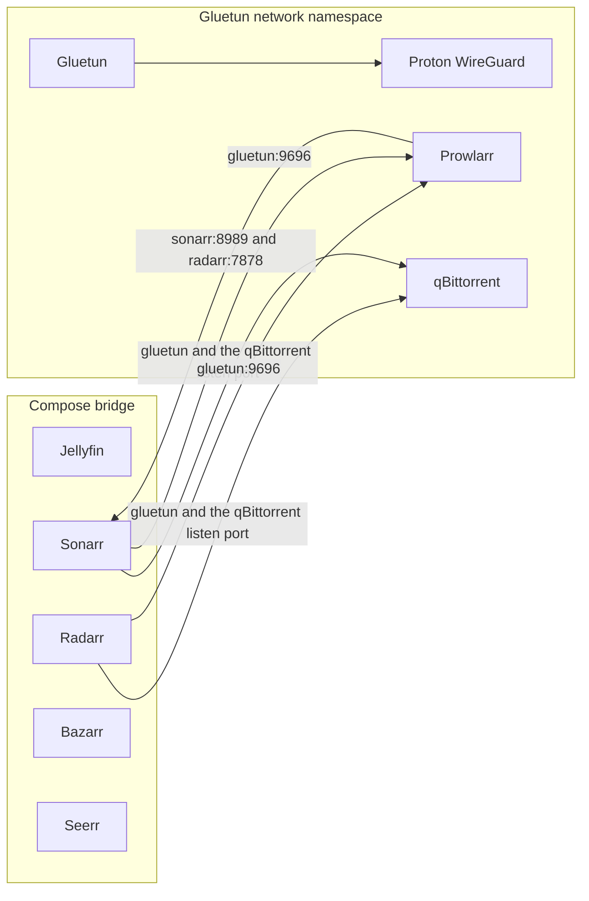

# How the bootstrap works

This is the companion to the step-by-step [README](../README.md). It describes the Compose file, the scripts, and the security limits of this setup.

## Layout

`bootstrap.sh` writes `.env` and creates two trees:

- `config/<app>/` is each app's database and settings. API keys land in `config/sonarr/config.xml`, `config/radarr/config.xml`, and `config/prowlarr/config.xml` on first start. `bootstrap.sh` creates `config/seerr` before Seerr starts so that process can write `settings.json` there. The LinuxServer images adjust ownership of their own config folders on startup.
- `media/movies`, `media/series`, and `media/downloads` are the files the apps share.

`.env` supplies the timezone, user id, group id, bind address, and host ports. The Compose file reads those variables, so nothing is hard-coded to one home directory.

`docker compose up` starts the core services: Jellyfin, Radarr, Sonarr, Bazarr, and Seerr. Gluetun, qBittorrent, and Prowlarr belong to the `vpn` profile. `bootstrap.sh` adds `--profile vpn` only when `WIREGUARD_PRIVATE_KEY` is set to something other than an empty value or `replace-me`.

Images are the current `latest` tags from LinuxServer, Seerr, and Gluetun. A later pull can change behavior. Pin a tag in `compose.yml` when you want a frozen set.

GPU transcoding is left off. A machine without the NVIDIA container toolkit can still boot. People who want NVENC later install that toolkit, then add `gpus: all` under the `jellyfin` service and pick NVIDIA in Jellyfin's playback settings. That change restarts Docker on the host, so it is a separate decision from this bootstrap.

## Two networks

Jellyfin, Sonarr, Radarr, Bazarr, and Seerr join the normal Compose bridge. Their service names resolve there: `http://sonarr:8989`, `http://radarr:7878`.

qBittorrent and Prowlarr set `network_mode: service:gluetun`. They live inside Gluetun's network namespace. They do not get Docker DNS names of their own. Anything on the bridge reaches them through the name `gluetun`.

Gluetun's healthcheck looks for an IPv4 address on `tun0`. qBittorrent and Prowlarr wait for that check. qBittorrent also runs `scripts/wait-tunnel.sh`, which blocks its own process until `tun0` has an address, because Compose has been observed starting the app before the healthcheck wait finishes. When the tunnel drops, that namespace has no default route around the VPN. Gluetun is the firewall for those two apps.

Host ports and in-container ports are not always the same number:

| App | Published as | Reachable inside Docker as |
| --- | --- | --- |
| Jellyfin | `JELLYFIN_PORT` to container `8096` | `jellyfin:8096` |
| Sonarr | `SONARR_PORT` to container `8989` | `sonarr:8989` |
| Radarr | `RADARR_PORT` to container `7878` | `radarr:7878` |
| Bazarr | `BAZARR_PORT` to container `6767` | `bazarr:6767` |
| Seerr | `SEERR_PORT` to container `5055` | `seerr:5055` |
| Prowlarr | `PROWLARR_PORT` to container `9696` | `gluetun:9696` |
| qBittorrent | `QBITTORRENT_PORT` to the same port | `gluetun:<QBITTORRENT_PORT>` |

qBittorrent is the exception. Recent versions reject the WebUI with `Unauthorized` when the port in the browser's `Host` header differs from the port the app listens on. The publish mapping is `${QBITTORRENT_PORT}:${QBITTORRENT_PORT}`, and `WEBUI_PORT` is that same value. Changing the host port means changing the listen port too. `scripts/wire-apps.sh` tells Sonarr and Radarr to use `gluetun` and `QBITTORRENT_PORT`.

Prowlarr keeps listening on `9696` inside the namespace. You can publish a different host port without changing the URL the other containers use.

## Shared folders

Sonarr, Radarr, and qBittorrent all mount `media/downloads` at `/downloads`. Sonarr's library mount is `media/series` at `/series`. Radarr's is `media/movies` at `/movies`. Because the download path is the same string in every container, Sonarr and Radarr do not need a remote path mapping.

Jellyfin mounts the whole `media` directory read-only at `/media`. Libraries in the wizard are `/media/movies` and `/media/series`.

LinuxServer containers run as `PUID` and `PGID` from `.env`. `bootstrap.sh` sets those to the user who ran it.

## What wire-apps.sh changes

The script runs on the host and talks to the published ports. It waits until the three `config.xml` files exist and `/ping` answers.

For Prowlarr it loads `/api/v1/applications/schema`, fills `prowlarrUrl` (`http://gluetun:9696`), `baseUrl` (`http://sonarr:8989` or `http://radarr:7878`), and that app's API key, and keeps the schema's default category lists. It creates or updates the application, then calls Prowlarr's own `/api/v1/applications/test`.

For Sonarr and Radarr it loads `/api/v3/downloadclient/schema`, fills the qBittorrent host, port, username, and password, and sets the category field (`tvCategory=sonarr`, `movieCategory=radarr`). It creates or updates the client, then calls `/api/v3/downloadclient/test` with the same body it saved. The test response hides the password, so the script sends the original body again.

Indexers are untouched. Seerr's wizard is also untouched: it asks for a Jellyfin API key that exists only after a person creates one in the Jellyfin dashboard.

## Security

This stack is a set of admin sites on your home network, plus a VPN for the downloader. Treat it that way.

**Do not port-forward the admin UIs to the internet.** Jellyfin, Sonarr, Radarr, Bazarr, Seerr, qBittorrent, and Prowlarr all publish on `BIND_ADDRESS`. The default `0.0.0.0` means every interface on the computer. That is what you want for other devices at home. A router rule that forwards those ports to the public internet exposes the admin tools. Leave them off the WAN. If the server has an extra interface, set `BIND_ADDRESS` to the LAN address.

**`.env` and the API keys are secrets.** `.env` holds the WireGuard private key and the qBittorrent password. `chmod 600` is applied by `bootstrap.sh`. `config/*/config.xml` holds API keys that can change Sonarr, Radarr, and Prowlarr settings. `.gitignore` excludes `.env`, `config/`, and `media/`. Do not paste those files into chat, tickets, or a public repo.

**The qBittorrent password is generated per machine.** `bootstrap.sh` writes a fresh alphanumeric password into `.env` and passes it to the image as `WEBUI_PASSWORD`. There is no shared default to log in with. The image would otherwise invent a new random password on every start and the wiring script would never match. Changing the password in `.env` applies on the next `docker compose --profile vpn up -d qbittorrent`.

**One WireGuard private key, one active session.** Proton disconnects the older session when the same key connects again. Running this stack with a key that is already in use on your phone or on another server drops that other session. Give this server its own key from the Proton WireGuard page.

**Turn on authentication before anyone else can open the LAN ports.** Fresh Sonarr, Radarr, and Seerr installs are reachable by anyone who can hit the port until their wizards set a password. Jellyfin is the same until the admin user exists. Finish those wizards before you tell other people the address. Bazarr and Prowlarr have their own auth settings; turn them on as well. qBittorrent's login is the pair in `.env`.

**Seerr can trigger downloads.** A person who can use Seerr can ask Sonarr and Radarr to grab something. Keep Seerr on the LAN, behind its own login, and away from port forwards.

**qBittorrent and Prowlarr have the tunnel as their only network.** Their `network_mode` is Gluetun's namespace, and they wait until `tun0` exists. Do not switch them to a normal bridge port mapping to "make the page load faster." That would give them a route that does not go through Proton. The host still publishes their web ports through Gluetun, so those web ports follow the same rule as the other admin UIs: LAN only.

**The isolated test is a separate Compose project.** `scripts/test-isolated.sh` uses project name `jfboot-test`, a temporary directory, and `127.0.0.1` on ports `18096`, `17878`, `18989`, `15055`, and `16767`. It starts the core services only. It does not start Gluetun, so it cannot open a second Proton session or kick a tunnel that is already up. It removes the temporary project when it finishes.
